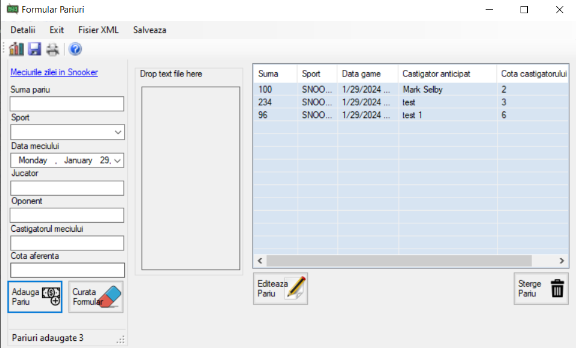

# Sports Betting Manager

A Windows desktop application for managing sports betting slips, built as a college project. Supports full CRUD operations, data persistence via XML serialization and SQL Server, and includes a custom-drawn chart component.

## Tech Stack

C# · Windows Forms · Entity Framework · SQL Server · XML Serialization 

## Features

- Create, view, edit, and delete betting slips for snooker matches
- Input validation with error providers
- Save data to SQL Server via Entity Framework
- Serialize and deserialize the betting list to/from XML
- Export data to a plain text file
- Print betting slips with print preview and page setup
- Drag and drop a text file to import bets
- Custom bar chart component (ChartLibrary) built with GDI+ - no third-party charting library
- Context menu and keyboard shortcuts (Ctrl+P to print, Ctrl+S to export)
